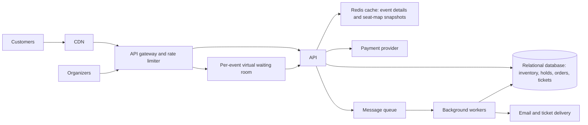

# TicketHub System Design

TicketHub sells tickets for concerts and other live events. The design supports
ordinary browsing and purchases as well as a sudden rush when a popular event
goes on sale. Seat inventory is authoritative in a relational database so that
concurrent requests cannot sell the same seat twice.

## 1. Requirements

### Functional requirements

- Browse, search, and view events, venues, prices, and event details.
- Show seat availability and allow a customer to select one or more seats.
- Temporarily hold selected seats while the customer checks out.
- Accept payment, confirm an order, and issue tickets.
- Let customers view their orders and tickets, and cancel or refund when the
  event's policy permits it.
- Release seats when a hold expires or a payment fails.
- Allow event organizers to create events and configure prices and on-sale times.

### Non-functional requirements

- **Correctness:** A seat may have at most one active hold and one sold ticket
  for an event. Inventory updates must be strongly consistent.
- **Availability:** Event browsing should remain available during checkout
  surges. Target 99.9% monthly availability for customer-facing APIs.
- **Performance:** Target p95 under 300 ms for cached event reads and under
  500 ms for seat selection and order reads, excluding the external payment
  provider.
- **Burst handling:** A high-demand on-sale must not overload the inventory
  database. Customers may wait in a queue rather than receive an incorrect
  availability result.
- **Fairness:** Customers should have an equal, understandable chance to enter
  checkout. Use a published admission policy, limit admission tokens per
  account, and show queue status rather than letting repeated requests improve
  a customer's place.
- **Security:** Authenticate customers and organizers, authorize every order
  access, validate requests, and never store raw payment-card details.
- **Reliability:** Payment and order operations are idempotent and recoverable
  after retries or service interruptions.

## 2. Traffic and capacity estimates

These estimates use the supplied user, visit, page-view, and ticket-sale
figures. Peak multipliers and API calls per buyer are planning assumptions,
not supplied facts; validate them with traffic measurements and load tests.

### Assumptions

- 2,000,000 registered users; 50,000 people visit on a normal day (2.5% of
  registered users).
- Each normal-day visitor views 10 pages.
- Ordinary peak page-view traffic is estimated at 10 times the daily average.
- 5,000 tickets are sold on a normal day.
- For a popular concert, 200,000 people try to buy its 20,000 seats during the
  first 10 minutes.
- For a rough on-sale API estimate, each interested buyer makes six API calls
  across the attempt (such as viewing the event and seats, attempting a hold,
  and checking out). This is an assumption; actual calls per buyer will vary.
- On-sale API traffic can briefly spike to five times its 10-minute average.
- The waiting room's admission rate is set using load-test results; 350
  seat-hold attempts per second is an initial planning target, not a measured
  database limit.

### Ordinary traffic

Daily page views:

`50,000 visitors × 10 pages = 500,000 page views/day`

Average page-view rate:

`500,000 ÷ 86,400 ≈ 5.8 page views/second`

Using the assumed 10× daily-average peak, plan for approximately **58 page
views/second**. A page view can trigger multiple API requests, so API capacity
must be sized from instrumentation rather than treating page views as API
requests. Normal ticket sales average `5,000 ÷ 86,400 ≈ 0.058 tickets/second`
(about **5,000 tickets/day**).

### Very popular concert on sale

Average buyer-attempt arrival rate over the 10-minute sale window:

`200,000 people ÷ 600 seconds ≈ 333 buyer attempts/second`

There are **10 people trying for each seat** (`200,000 ÷ 20,000`). At the
average arrival rate, six API calls per buyer imply about **2,000 API requests
per second**. A 5× short burst is approximately **10,000 API requests per
second**. Actual API load depends on retries and user behavior.

The estimated short burst of 10,000 API requests/second is roughly **173
times** the normal estimated peak of 58 page views/second; this is only an
indicative comparison because page views and API requests are not the same
measure. In buyer-arrival terms, the sale's 333 attempts/second is about
**576 times** the normal average visitor arrival rate: 50,000 visitors/day
averages about 0.58 visitors/second. If all 20,000 seats sell uniformly over
10 minutes, that is about **33 tickets/second**, versus about **0.058
tickets/second** averaged across a normal day.

The waiting room absorbs the difference between the burst and the admitted
rate. At the initial planning target of 350 seat-hold attempts/second, it can
admit the estimated average arrival rate; if arrivals spike above that, the
queue grows and customers wait. The service should lower or raise this limit
based on load tests and live database health, and stop admitting buyers when
inventory is exhausted.

## 3. API

Base path: `/api/v1`. JSON is used for request and response bodies.

| Method and endpoint | Purpose | Important behavior |
|---|---|---|
| `GET /events?query=&date=&venueId=` | Search upcoming events | Paginated; results may be cached. |
| `GET /events/{eventId}` | Get event details and sale status | Returns venue, time, pricing summary, and whether the sale is open. |
| `GET /events/{eventId}/seats` | Read seat-map availability | Availability is advisory; a seat is not guaranteed until a hold succeeds. |
| `POST /events/{eventId}/holds` | Hold one or more seats | Requires an admission token during a gated sale and an `Idempotency-Key`; atomically succeeds for all requested seats or none. Returns a hold ID and expiry. |
| `POST /holds/{holdId}/checkout` | Pay for a valid hold | Requires an idempotency key; returns a pending or confirmed order state. |
| `GET /orders/{orderId}` | Read an order and its tickets | Only the owning customer or an authorized organizer can access it. |
| `GET /me/tickets` | List the signed-in customer's tickets | Returns tickets for the authenticated customer, optionally filtered by event; does not expose another customer's tickets. |
| `DELETE /holds/{holdId}` | Release a customer's hold | Idempotent; already expired or completed holds do not become available twice. |

Typical errors include `409 Conflict` when a requested seat is no longer
available, `410 Gone` for an expired hold, `429 Too Many Requests` when
rate-limited, and `503 Service Unavailable` when checkout cannot safely proceed.
Clients should retry transient failures using the same idempotency key.

## 4. Data model

Use a relational database (for example, PostgreSQL) as the source of truth for
seat inventory, holds, orders, and tickets. Primary and foreign keys enforce
relationships; money is stored as integer minor units (such as cents).

| Table | Important fields and constraints |
|---|---|
| `users` | `id` primary key, `email` unique, `created_at` |
| `venues` | `id` primary key, `name`, `address` |
| `venue_seats` | `id` primary key, `venue_id` foreign key to `venues`, `section`, `row`, `seat_number`; unique `(venue_id, section, row, seat_number)` |
| `events` | `id` primary key, `venue_id` foreign key to `venues`, `name`, `starts_at`, `sale_starts_at`, `status` |
| `event_seats` | `event_id` foreign key to `events`, `venue_seat_id` foreign key to `venue_seats`, `price_minor`, `currency`, `status`, nullable `hold_id` foreign key to `holds`, `hold_expires_at`; primary key `(event_id, venue_seat_id)` |
| `holds` | `id` primary key, `user_id` foreign key to `users`, `status`, `expires_at`, `created_at`; a hold can contain several seats |
| `hold_items` | `hold_id` foreign key to `holds`, `event_id`, `venue_seat_id`, `price_minor`; primary key `(hold_id, event_id, venue_seat_id)`, foreign key `(event_id, venue_seat_id)` to `event_seats` |
| `orders` | `id` primary key, `user_id` foreign key to `users`, `hold_id` unique foreign key to `holds`, `status`, `total_minor`, `payment_reference` unique |
| `tickets` | `id` primary key, `order_id` foreign key to `orders`, `event_id`, `venue_seat_id`, `issued_at`; unique `(event_id, venue_seat_id)` and foreign key `(event_id, venue_seat_id)` to `event_seats` |

Relationships:

- A venue has many venue seats and hosts many events.
- An event has one inventory row per venue seat; its `event_seats` rows hold
  event-specific prices and availability.
- A user can create many holds and orders. A hold contains many `hold_items`.
- A completed order can issue many tickets, but each event seat can appear in
  at most one ticket.

## 5. Preventing double-booking

The seat map is only a snapshot; the database decides whether a hold or sale
succeeds. The hold service uses one database transaction for all requested
seats:

1. Lock the relevant `event_seats` rows in a consistent order, or perform a
   conditional update that changes a row only when it is `AVAILABLE` (or its
   previous hold has expired).
2. Verify every requested row was acquired. If any row was already held or
   sold, roll back the whole transaction and return `409 Conflict`.
3. Set the rows to `HELD`, attach the new hold ID and expiry, and insert the
   corresponding hold and hold-item records before committing.
4. On successful payment, transition the hold to `CONFIRMED`, mark inventory
   `SOLD`, create the tickets, and commit those database changes together.
   The unique `(event_id, venue_seat_id)` constraint on `tickets` is a final
   integrity barrier.

Concurrent requests cannot both change the same inventory row from available
to held: the row lock or conditional update allows only one transaction to
win. A short hold expiry releases abandoned seats. Payment happens outside the
database transaction; its result is applied only if the matching hold ID is
still valid. A late payment for an expired/reassigned hold is voided or
refunded, never used to issue a ticket. Idempotency keys prevent retries from
creating duplicate orders or charges.

## 6. Architecture and big-sale resilience

Component responsibilities:

- **CDN:** Serves static assets and absorbs cacheable public traffic near
  customers.
- **API gateway and rate limiter:** Terminates TLS, validates authentication,
  applies request limits, and routes requests to services.
- **Virtual waiting room:** Queues sale traffic per event and issues admission
  tokens at a rate the inventory service and database can sustain. To make
  admission fair, customers present at the announced sale start are assigned
  randomized places; later arrivals join in arrival order. Tokens are
  short-lived and limited per account, and the queue reports a status and
  estimated wait. Browsing can bypass the queue; seat-hold requests require a
  valid admission token.
- **TicketHub application services:** Handle event search, seat holds, order
  state transitions, authorization, and payment-provider integration.
- **Redis cache:** Speeds up event details and seat-map snapshots. It is not
  authoritative for seat ownership; hold and purchase decisions always use the
  relational database.
- **Relational database:** Stores the source of truth and enforces row-level
  concurrency control, foreign keys, and uniqueness constraints.
- **Payment provider:** Tokenizes and processes payment without TicketHub
  storing raw card data. Payment results are reconciled against the hold state.
- **Message queue and background workers:** Retry non-interactive tasks such as
  confirmation emails, ticket delivery, and hold-expiry cleanup without
  blocking API responses.

During a big sale, the CDN and cache absorb repeat event and seat-map reads.
The gateway rate-limits abusive or excessive requests, while the waiting room
smooths the arrival burst and admits seat-hold attempts at the database's
planned limit. The transactional database remains authoritative, so cached
seat maps cannot oversell inventory. Background workers handle delivery and
cleanup asynchronously, keeping checkout APIs focused on hold and payment
state. If a dependency is unhealthy, the service fails checkout safely rather
than confirming a seat it cannot reserve.

## 7. Trade-offs

1. **Relational transactions vs. horizontal write scaling:** A relational
   database makes seat uniqueness and multi-seat all-or-nothing holds
   straightforward and reliable. It is harder to scale writes across many
   database shards. Start with a primary database and read replicas; partition
   inventory by event only if measured write volume requires it, keeping each
   event's seats in one transactional partition.
2. **Waiting room vs. immediate access:** Queueing smooths bursts and protects
   checkout correctness, but adds waiting time and requires clear customer
   status and fair admission rules. Without it, the system risks overload and
   failed or inconsistent checkouts.
3. **Short seat holds vs. customer convenience:** A short expiry improves
   inventory turnover and limits abandoned reservations, but customers with
   slow payment flows may lose their seats. Use a visible countdown, a
   reasonable fixed duration, and reliable expiry handling rather than
   extending holds without limit.